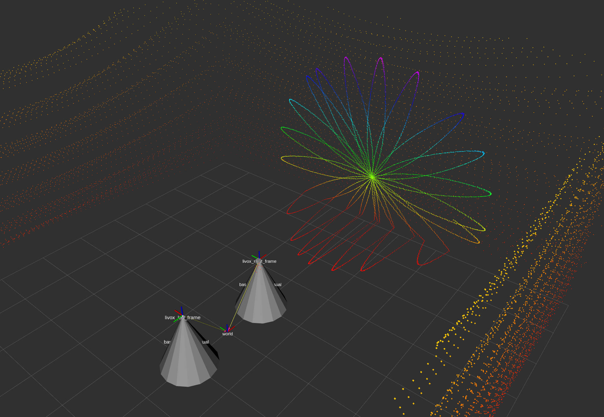

<!-- SPDX-FileCopyrightText: 2026 FZ_XiaoXi -->
<!-- SPDX-License-Identifier: Apache-2.0 -->

<div align="center">

# Livox Lidar Gazebo Sim Sensor

基于 ROS 2 Jazzy 与 Gazebo Harmonic 的 Livox 激光雷达模拟插件

<p>
  <a href="https://ubuntu.com/"></a>
  <a href="https://www.ros.org/"></a>
  <a href="https://gazebosim.org/"></a>
</p>

</div>

本项目基于 [Livox laser simulation](https://github.com/Livox-SDK/livox_laser_simulation) 的扫描模式数据和实现思路，迁移到 Gazebo Harmonic 仿真平台。仓库根目录为 ROS 2工作空间，其中一个插件包、一个示例包。



> 维护者目前手上只有 Livox Mid-70，其余型号雷达的尺寸、质量、mesh、CSV 扫描轨迹和仿真效果没有实物验证，仅供参考。Horizon 和 Mid-40 因官网已经不再支持，本项目不配置默认 mesh，外形、质量、碰撞和点云结果均不保证正确。

## 快速导航

| 内容 | 入口 |
| --- | --- |
| 安装、构建和一键运行 | [用户部分](#用户部分) |
| 型号宏、参数和多雷达配置 | [插件使用](#插件使用) |
| 双雷达可交互场景 | [示例工程](#示例工程) |
| 插件架构 | [开发部分](#开发部分) |
| 已知限制 | [约定和限制](#约定和限制) |

## 仓库结构

```text
ros_ws/
├── README.md
├── LICENSE
├── NOTICE
└── src/
    ├── livox_lidar_gz_sensor/      # Gazebo Sim 插件包
    │   ├── include/                # 头文件
    │   ├── src/                    # 源码
    │   ├── urdf/                   # 传感器 xacro 宏
    │   ├── scan_mode/              # 射线坐标文件
    │   └── meshes/                 # 激光雷达模型
    └── livox_lidar_example/        # 雷达仿真示例包
        ├── worlds/                 # 两个示例机器人、四面墙和地面
        ├── config/                 # bridge 与可选 RViz 配置
        ├── urdf/                   # 示例 RobotModel 描述（可选）
        └── launch/                 # ROS 2 启动文件
```

# 用户部分

## 环境要求

- Ubuntu 24.04
- ROS 2 Jazzy
- Gazebo Harmonic
- `ament_cmake`、`colcon`、`xacro`
- 示例运行依赖：`ros_gz_sim`、`ros_gz_bridge`、`rviz2`、`robot_state_publisher`
- 射线物理后端：当前插件射线仿真使用 DART + Bullet。Gazebo ODE 不支持本插件使用的 raycast 查询。

## 构建

```bash
cd ~/ros_ws
source /opt/ros/jazzy/setup.bash
export GZ_VERSION=harmonic

CCACHE_DISABLE=1 colcon build --symlink-install \
  --packages-select livox_lidar_gz_sensor livox_lidar_example

source install/setup.bash
```

`CCACHE_DISABLE=1` 只在本机 ccache 目录不可写时使用，正常环境可省略。

## 示例工程

位于 [`src/livox_lidar_example`](src/livox_lidar_example)，用于验证插件加载、射线命中、动态 TF 和 ROS bridge。它包含：

- 两个圆锥形状示例机器人，分别装有激光雷达；
- 每个机器人各有一个 model 级 `LivoxLidarSystem` 插件实例；
- 四面墙壁和地面；
- `ros_gz_bridge` 桥接 GZ 与 ROS 2 点云 / TF；
- 关闭重力，因此可交互实体不会自行掉落，方便移动物体测试射线效果。

示例中的 RobotModel 和 mesh 仅用于辅助观察模型位置，不是插件运行条件，也不属于本项目的传感器算法研究范围。

一键启动：

```bash
./src/livox_lidar_example/run_livox_example.sh
```

启动参数：

```bash
./src/livox_lidar_example/run_livox_example.sh gz_verbosity:=4
```

| 参数 | 默认值 | 作用 |
| --- | --- | --- |
| `gz_verbosity` | `3` | Gazebo 日志等级；`4` 显示更多调试信息 |

示例 ROS topic 和 TF：

```text
/livox_left/points       # Mid-360点云
/livox_right/points      # Mid-70点云
world -> livox_left_frame
world -> livox_right_frame
```

## 插件使用

插件库文件：

```text
liblivox_lidar_gz_sensor.so
```

最小 SDF：

```xml
<plugin
  filename="liblivox_lidar_gz_sensor.so"
  name="livox_lidar_system::LivoxLidarSystem"/>
```

插件可以挂在 `<model>` 或 `<world>`：

- model 级插件只处理该 model 及其子实体中的 Livox custom sensor，适合每个机器人独立配置；
- world 级插件处理整个世界中的 Livox custom sensor，适合统一管理；
- 同一个 sensor 不要同时被 world 和 model 级插件覆盖，否则会重复创建、射线和发布；
- hook 只设置 `GZ_SIM_SYSTEM_PLUGIN_PATH` 与 `GZ_SIM_RESOURCE_PATH`，不会自动把 plugin 实例插入 SDF。

### 型号宏

所有宏都要求唯一的 `link_name`。sensor、frame 和 point-cloud topic 由它自动派生：

```text
sensor name = ${link_name}_sensor
frame_id    = ${link_name}_frame
topic       = /${link_name}/points
```

| 型号 | xacro 文件 | link 宏 | 默认 mesh | 当前状态 |
| --- | --- | --- | --- | --- |
| Mid-70 | `urdf/livox_mid70.xacro` | `livox_mid70_link` | `mid70.dae` | 可用于验证 |
| Mid-360 | `urdf/livox_mid360.xacro` | `livox_mid360_link` | `mid360.dae` | 仅参考，未用实物验证 |
| Avia | `urdf/livox_avia.xacro` | `livox_avia_link` | `avia.dae` | 仅参考，未用实物验证 |
| HAP | `urdf/livox_HAP.xacro` | `livox_hap_link` | `HAP.dae` | 仅参考，未用实物验证 |
| Tele | `urdf/livox_tele.xacro` | `livox_tele_link` | `tele.dae` | 仅参考，未用实物验证 |
| Horizon | `urdf/livox_horizon.xacro` | `livox_horizon_link` | 无默认 mesh | 官网不再支持，外形 / 质量 / 碰撞 / 点云不保证 |
| Mid-40 | `urdf/livox_mid40.xacro` | `livox_mid40_link` | 无默认 mesh | 官网不再支持，外形 / 质量 / 碰撞 / 点云不保证 |


### 坐标系、pose 和安装孔

xacro 中的传感器坐标以激光雷达点云坐标系为原点：

- `link_pose` 表示承载雷达 link 在父模型中的 pose；`sensor_pose` 默认全零时，link 原点、Gazebo custom sensor 原点和点云坐标系原点重合；
- 如果把 `sensor_pose` 设为非零，custom sensor / 点云原点就相对 link 移动，TF 也跟随 sensor entity；
- `mesh_pose` 只移动视觉 mesh，不改变射线坐标、TF 或点云 frame；
- 真实设备的定位孔、底面和外壳相对点云原点的偏移，需要根据对应型号手册自行设置 `link_pose`、`sensor_pose` 或 `mesh_pose`。

不要把 visual mesh 的几何中心当作点云坐标原点。射线和点云在 `${link_name}_frame` 中发布，插件通过传感器 entity 的 world pose 发布 `world -> ${link_name}_frame`。

### 公共 xacro 参数

| 参数 | 默认 / 类型 | 作用 |
| --- | --- | --- |
| `link_name` | 必填字符串 | link、sensor、frame 和 topic 的命名根，必须全局唯一 |
| `link_pose` | `x y z roll pitch yaw` | 点云 link 原点在父模型中的 pose |
| `sensor_pose` | `x y z roll pitch yaw` | custom sensor 在 link 中的 pose |
| `mesh_file` | 型号默认路径或空字符串 | Gazebo visual mesh |
| `mesh_scale` | `1 1 1` | Gazebo mesh 缩放 |
| `mesh_pose` | 零 pose | Gazebo visual mesh 相对 link 的偏移 |
| `scan_file` | 型号 CSV | `Time/s,Azimuth/deg,Zenith/deg` 扫描轨迹 |
| `update_rate` | Hz | 点云扫描发布频率 |
| `range_min` / `range_max` | 米 | 射线起止距离 |
| `downsample` | 正整数 | 降采样，若设置为2，则每秒20万点的雷达实际计算10万点 |
| `noise_mean` / `noise_stddev` | 米 | 沿射线方向的高斯距离噪声 |

调用示例：

```xml
<xacro:include filename="$(find livox_lidar_gz_sensor)/urdf/livox_mid70.xacro"/>

<xacro:livox_mid70_link
  link_name="front_mid70"
  link_pose="0.25 0 1.20 0 0 0"
  update_rate="20"
  range_min="0.1"
  range_max="70.0"
  downsample="2"
  noise_stddev="0.01"/>
```

### 同时配置不同雷达

在同一个 model 中 include 多个型号文件，调用多个 link 宏即可。每个 `link_name` 必须不同，固定 joint 的 child 也必须不同；System plugin 只需要一个：

```xml
<xacro:include filename="$(find livox_lidar_gz_sensor)/urdf/livox_mid70.xacro"/>
<xacro:include filename="$(find livox_lidar_gz_sensor)/urdf/livox_avia.xacro"/>

<xacro:livox_mid70_link
  link_name="robot1_top_mid70"
  link_pose="0 0 1.0 0 0 0"/>
<xacro:livox_avia_link
  link_name="robot1_front_avia"
  link_pose="0.3 0 0.8 0 0 0"/>

<joint name="robot1_top_mid70_joint" type="fixed">
  <parent>base_link</parent>
  <child>robot1_top_mid70</child>
</joint>
<joint name="robot1_front_avia_joint" type="fixed">
  <parent>base_link</parent>
  <child>robot1_front_avia</child>
</joint>

<plugin
  filename="liblivox_lidar_gz_sensor.so"
  name="livox_lidar_system::LivoxLidarSystem"/>
```

多个机器人时给命名根加机器人前缀，例如 `robot1_top_mid70`、`robot2_top_mid70`。不要让不同机器人复用同一个 `link_name`，否则点云 topic 和 TF frame 会冲突。多个 model 级插件实例可以共存；world 级插件则可统一处理所有机器人，但不要再对同一 model 重复挂载。

### Gazebo mesh 与 RViz 点云显示边界

本项目主要实现传感器插件、CSV 扫描轨迹、射线查询和点云发布。Gazebo SDF / xacro 中的 `mesh_file` 只控制传感器 link 的可选视觉几何，不参与 CSV 扫描、射线生成、物理命中或点云打包。Gazebo 使用 `<geometry><mesh><uri>...</uri><scale>...</scale></mesh></geometry>`，本项目默认通过 `$(find livox_lidar_gz_sensor)/meshes/*.dae` 展开，并由 Gazebo 资源路径解析。

RViz 可以只订阅桥接后的 `sensor_msgs/msg/PointCloud2`，不需要 `robot_state_publisher`、RobotModel 或任何雷达 mesh。将 PointCloud2 display 的 topic 设为对应的 `/${link_name}/points`；纯点云检查时可直接把 Fixed Frame 设为 `${link_name}_frame`，需要放到 `world` / `map` 中显示时才配置相应 TF。点云的 `frame_id` 由插件配置为 `${link_name}_frame`。因此，RViz 只显示纯点云即可验证插件输出。

示例提供 `src/livox_lidar_example/urdf/livox_display.urdf.xacro` 和 RobotModel 配置，只是可选的外部辅助显示。它使用 URDF 的 `package://...` mesh URI，由 `robot_state_publisher` 和 RViz 解析；该模型不会改变 Gazebo 中的 link、传感器 pose 或点云坐标。Gazebo mesh 与 RViz mesh 的位置、缩放、坐标原点及同步关系不属于本项目的研究和保证范围，应由使用者在自己的模型中单独校准。

Gazebo 当前示例主要使用 COLLADA `.dae`，RViz 的具体 mesh 格式取决于其渲染器和 URDF 解析链路；mesh 无法显示时分别检查 Gazebo 资源路径或 ROS package share 路径。mesh 显示失败不会影响插件发布点云。

# 开发部分

## Sensor 与 System 分工

`LivoxLidarSystem` 是 Gazebo Sim system：

- `Configure` 保存 owner entity，并创建 owner-scoped TF publisher；
- `PreUpdate` 用 `EachNew<CustomSensor, ParentEntity>` 发现自己 owner 下的新 sensor；
- 对 `gz:type` 以 `livox_` 开头的 sensor 创建 `LivoxLidarSensor`；
- 生成当前扫描窗口的射线，写入该 sensor entity 的 `components::RaycastData`；
- `PostUpdate` 读取物理命中结果，把结果交给 Sensor，发布点云和 `world -> frame_id` TF；
- `EachRemoved` 清理被删除 sensor 的扫描时间、raycast 和实例状态。

`LivoxLidarSensor` 继承 `gz::sensors::Sensor`：

- `Load` 解析 `gz:livox_config`、CSV、量程、降采样和噪声；
- `GenerateRays` 根据 CSV 时间窗口生成传感器坐标系的射线；
- `Update` 将命中点打包为 `gz.msgs.PointCloudPacked` 并发布；
- Gazebo 的 `update_rate` 决定窗口周期，CSV 的时间跨度和点率决定每个窗口包含多少条射线。

运行流程：

```text
SDF / xacro
  -> CustomSensor entity
  -> LivoxLidarSystem::PreUpdate
  -> CSV 时间窗口 + GenerateRays
  -> components::RaycastData
  -> Gazebo Physics / Bullet
  -> LivoxLidarSystem::PostUpdate
  -> PointCloudPacked + owner-scoped TF
  -> ros_gz_bridge
  -> PointCloud2 + /tf
  -> 可选的 RViz2 PointCloud2 display
```

命中点和点云保持在 sensor frame。不要在发布前再次套用 world 到 sensor 的逆变换，否则会重复变换。

## 约定和限制

- `gz:type` 使用 `livox_<model>`，System 通过前缀发现，不需要为每个型号新增 System 类；
- CSV 必须为三列，时间非递减；HAP 的重复时间戳会作为同一时刻的多束射线保留；
- 当前 `intensity` 固定为 `1.0`，没有材质反射率模型；
- 多回波、不同扫描模式、IMU、厂商数据包协议、回波强度和其他设备专有功能均未模拟；
- 当前扫描逻辑使用 CSV 轨迹和周期窗口，不等价于实际设备的全部时序、回波和内部调度；
- 当前每个 physics step 最多提交一个完整扫描窗口；如果仿真时间一次跨过多个 `update_rate` 周期，积压窗口会在后续 physics step 逐个追赶，可能短时连续发布；应避免仿真步长或暂停恢复跨度大于扫描周期；
- 射线查询目前不根据点云订阅者数量短路，多个高点率雷达会带来明显 CPU / Physics 开销；应通过 `downsample`、`update_rate` 和数量控制性能；
- 旧项目中的 `visualize`、规则 ray FOV、角分辨率、`samples`、`resolution` 等字段没有伪造迁移；
- 当前已验证的点云消息为 `gz.msgs.PointCloudPacked`，ROS 2 输出依赖 `ros_gz_bridge`，插件本身不直接依赖 ROS 2 消息库。

## 构建和检查

```bash
source /opt/ros/jazzy/setup.bash
export GZ_VERSION=harmonic
CCACHE_DISABLE=1 colcon build --symlink-install
source install/setup.bash

# XML / xacro
xmllint --noout src/livox_lidar_gz_sensor/urdf/livox_mid70.xacro
xacro src/livox_lidar_example/worlds/livox_example.world.xacro \
  -o /tmp/livox_example.sdf
gz sdf -k /tmp/livox_example.sdf

# 插件接口
gz plugin -i -p \
  install/livox_lidar_gz_sensor/lib/liblivox_lidar_gz_sensor.so

# 运行数据
gz topic -e -t /livox_example_robot_1/tf
ros2 topic echo /livox_left/points --once
